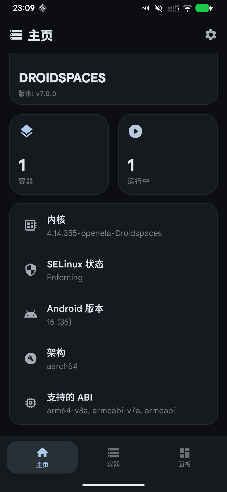
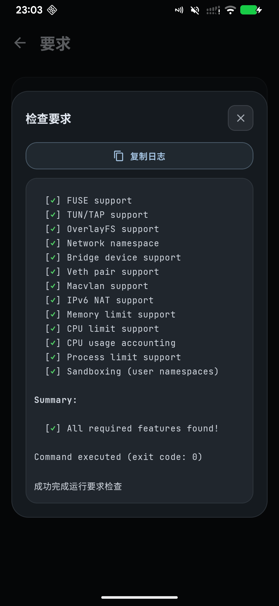
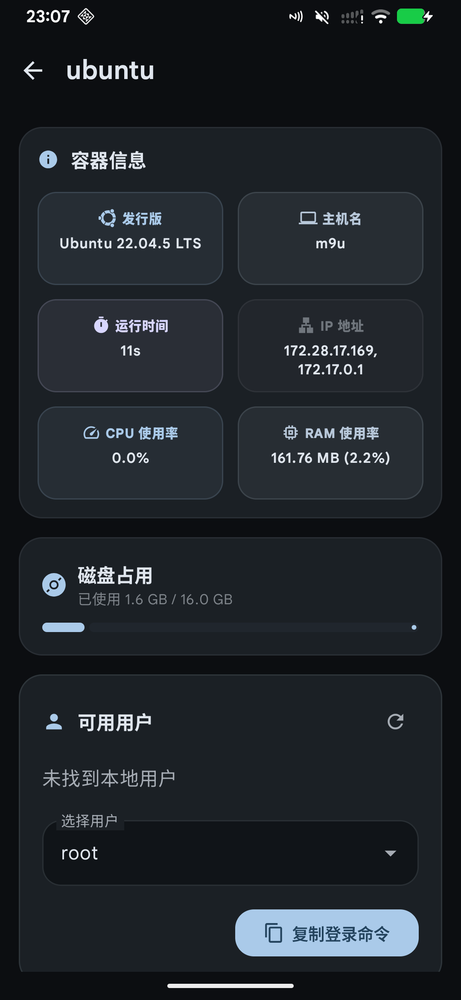

# cepheus Droidspaces Kernel (crDroid 16)

A Droidspaces-ready kernel for the Xiaomi Mi 9 (**cepheus**) running **crDroid 16 (Android 16)**, packaged as an [AnyKernel3](https://github.com/osm0sis/AnyKernel3) zip. Kernel release string: `4.14.355-openela-Droidspaces`. It is built from the exact source of the InfiniR kernel shipped in crDroid 16 official builds ([`raystef66/kernel_xiaomi_cepheus`](https://github.com/raystef66/kernel_xiaomi_cepheus), branch `16.0-ksun`, commit `6ad047b7`), using the stock kernel configuration plus a Droidspaces delta — namespaces, `CONFIG_CFS_BANDWIDTH` (`--cpus`), `CONFIG_POSIX_MQUEUE`, overlayfs — with **zero source-code changes up to v5**; v6 adds exactly one 5-line fix in `fs/file.c::__range_close()` (see *Test results* below). [KernelSU-Next](https://github.com/KernelSU-Next/KernelSU-Next) with [SUSFS](https://gitlab.com/simonpunk/susfs4ksu) is integrated in manual-hook mode; the version actually compiled in, measured from the built image, is **v3.0.1-legacy-88-g00cb93e0** (see the honesty note below). **Tested on cepheus + crDroid 16.0 (20260912, v12.12): v5 booted 2026-10-20, v6 flashed / booted / container-validated 2026-10-22.** For cepheus + crDroid 16 only — back up your boot partition before flashing.

---

# 小米 9（cepheus）Droidspaces 内核 — crDroid 16

适用于小米 9（cepheus）+ crDroid 16（Android 16）的 Droidspaces 内核，AnyKernel3 刷机包。内核版本串：`4.14.355-openela-Droidspaces`。

## 源码血统（重要，认版本号不认组织名）

- 基线源码：[`raystef66/kernel_xiaomi_cepheus`](https://github.com/raystef66/kernel_xiaomi_cepheus)，分支 `16.0-ksun`，commit `6ad047b70d809d7dee1fc090dbe2c252ff43b7eb`。这是 crDroid 16 官方包内置的 InfiniR 内核（`v2.02_A16_KSUN`）的真实源码。
- ⚠️ **特别提醒**：[crDroid](https://github.com/crdroidandroid) 组织仓库的 [`android_kernel_xiaomi_sm8150`](https://github.com/crdroidandroid/android_kernel_xiaomi_sm8150)（4.14.356）**不是**这棵树。从组织树编译的内核在本机无法开机（已实测）。判断血统认版本号 **355**，不认组织名。

## 构建与配置

- **源码改动**：v5 及之前与上述上游 commit 完全一致（零改动）；**v6 起仅含一处 5 行修复** —— 在 `fs/file.c::__range_close()` 补回上游 5.9 的 `max_fd` 裁剪（`max_fd = min(last_fd(files_fdtable(cur_fds)), max_fd)`），修复容器内 `close_range(3, ~0U)` 永不退出的死循环。补丁文件 `patches/0001-fs-clamp-max_fd-in-close_range-backport.patch`，背景与验证见 `PATCH_NOTES.md`。
- 配置 = crDroid stock 内核的 `/proc/config.gz` 基线 + Droidspaces 增量；最终 `.config` 随本仓库一同发布（`cepheus-crDroid-Droidspaces-v5-config.txt`，v6 未改动配置）。

## [KernelSU-Next](https://github.com/KernelSU-Next/KernelSU-Next) 与 [SUSFS](https://gitlab.com/simonpunk/susfs4ksu)

- 集成方式：MANUAL_HOOK（手动 hook）。
- **实测版本（从编译出的 Image 提取字符串）**：[KernelSU-Next](https://github.com/KernelSU-Next/KernelSU-Next) **v3.0.1-legacy-88-g00cb93e0** + [SUSFS](https://gitlab.com/simonpunk/susfs4ksu) **v2.1.0**。
- 诚实注明：上游树的提交信息自称集成了 v3.2.0-legacy，但其 gitlink pin 的子模块内容经实测为 v3.0.1-legacy-88——标签与内容不符。本包一律以从 Image 实测的版本为准。

## Droidspaces / Docker 支持项

- PID / UTS / USER / IPC / NET 五个 namespace 全部开启
- `CONFIG_CFS_BANDWIDTH` 开启 → Droidspaces 的 `--cpus` 限制可用
- `CONFIG_POSIX_MQUEUE` 开启 → docker 无需 runc wrapper 剥除 `/dev/mqueue`
- `CONFIG_OVERLAY_FS` 开启
- `CONFIG_SCHED_WALT` 关闭（与 stock 一致，同时是 CFS_BANDWIDTH 可用的前提）
- TCP 默认拥塞控制为 BBR

## 实测状态

测试环境：小米 9（cepheus）+ crDroid 16.0（20260912，v12.12）+ Droidspaces v7.0.0 + KernelSU-Next（管理器 3.2.0）。

**v6（含 `close_range` 修复）— 2026-10-22**

- ✅ 刷入并成功开机（约 18 s 到达 `sys.boot_completed=1`），连续运行零 R 态自旋进程、零 Oops。
- ✅ Droidspaces 运行要求检查**全绿**（见下方截图）：FUSE / TUN-TAP / OverlayFS / Network namespace / Bridge / Veth / Macvlan / IPv6 NAT / Memory limit / CPU limit / CPU accounting / Process limit / Sandboxing(user namespaces) 共 13 项全部 `[✓]`。
- ✅ 容器 `ubuntu 22.04.5 LTS` 正常启动：systemd `is-system-running = running`，0 个 failed unit，journald / dbus / ssh / docker / containerd 等关键服务全 active。
- ✅ 缺陷复现点全部通过：`close_range(3, ~0U)` 直测返回 `0`（0.000 s）；`posix_spawn` 300 次 0.133 s；`systemctl restart` 循环 3/3 通过。
- ✅ 补充项：mqueue 可创建队列；veth 可建可删、`ip netns add` 正常；overlayfs 在 ext4 上挂载与写入正常。
- ⚠️ **cgroup / docker 能力边界**（Linux 4.14 固有限制，非本包缺陷）：
  - Docker 守护进程可运行，但**在 cgroup v2 模式下 `docker run` 会失败**：`bpf_prog_query(BPF_CGROUP_DEVICE) failed: invalid argument`。该 BPF 程序类型为 Linux 4.15 引入，4.14 缺失；需以 `--force-cgroupv1` 启动容器（此时 `docker run` 正常，`cgroup=cgroupfs`）。
  - `memory` 限额在任何模式下均不可用 —— Android 将该控制器独占绑定在 cgroup2；`cpu / cpuset / pids / blkio` 在 v1 模式下可用。
  - 仅运行 systemd 服务时**无需** cgroup v1；需要 docker 或资源限额时才需要。

**v5 — 2026-10-20**

- ✅ 在 cepheus + crDroid 16.0（20260912，v12.12）上刷入并成功开机。

### 测试效果图

| 环境概览 | 运行要求检查 | 容器运行状态 |
| :---: | :---: | :---: |
|  |  |  |
| 内核 `4.14.355-openela-Droidspaces`，SELinux Enforcing，Android 16 / aarch64 | 13 项能力全部 `[✓]`，`All required features found!` | Ubuntu 22.04.5 LTS，systemd 已就绪，端口转发 8122 → 22 |

## 刷机与回滚

- **刷机前务必先备份 boot 分区**（重要的事说三遍也不为过）。
- 刷机：在 OrangeFox / TWRP recovery 中刷入 `cepheus-crDroid-Droidspaces-v6.zip`（v5 包同样可用）。
  - 注意：若 `/data` 已加密，recovery 下的 `/sdcard` 里是密文目录名、`twrp install /sdcard/...` 会报 `Unable to locate zip file`。改为先 `adb push cepheus-crDroid-Droidspaces-v6.zip /tmp/` 再从 `/tmp` 刷入即可（AnyKernel3 刷 boot 不依赖 `/data`）。
- 回滚：`fastboot flash boot <原厂 boot.img>`，刷回备份的 boot 即可。
- **仅限 cepheus + crDroid 16**。其他设备、其他 ROM 请勿刷入。

## 源码与许可（GPLv2）

- 本内核遵循 GPLv2。因零源码改动，完整对应源码 = 上述上游仓库的该 commit + 本仓库发布的 `.config`，可自行复现构建。

## 致谢

- **[raystef66](https://github.com/raystef66)** — InfiniR 内核作者与维护者
- **[KernelSU-Next](https://github.com/KernelSU-Next/KernelSU-Next)** — 内核级 root 方案
- **[SUSFS](https://gitlab.com/simonpunk/susfs4ksu)** — 隐藏与补丁框架
- **[crDroid](https://github.com/crdroidandroid)** — ROM 与设备维护
- **[AnyKernel3](https://github.com/osm0sis/AnyKernel3)**（[osm0sis](https://github.com/osm0sis)）— 刷机包格式
